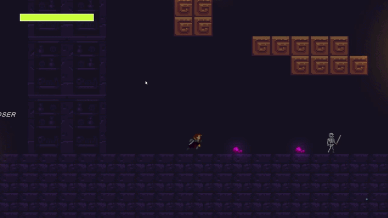
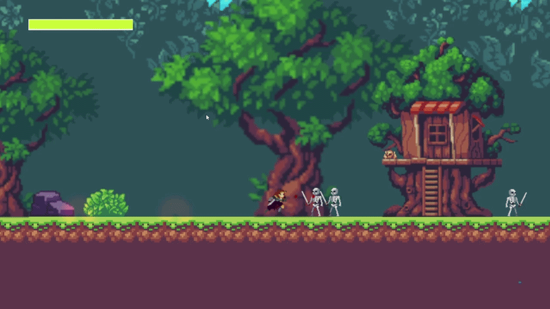

# Combat System

**2D Action Platformer Prototype | Unity | C#**

A 2D action-platformer prototype built to showcase my gameplay programming and combat system development skills. The project focuses on **responsive combat, player state management, and enemy interactions**. Three playable levels put the systems into a complete gameplay flow.

## Project Information

| | |
| --- | --- |
| **Type** | 2D Action Platformer Prototype |
| **Engine** | Unity |
| **Language** | C# |
| **Platform** | Windows |
| **Status** | Completed |

## Gameplay Preview

### Combat System & Combos

### Enemy Combat & Hit Feedback

### Gap Closer & Dash

## Implemented Systems

**Player combat and movement**
- Light attack combo system
- Heavy attack system
- Parry with automatic counterattack
- Gap closer with enemy targeting
- Dash system
- Player finite state machine

**Enemies and combat feedback**
- Enemy AI and combat states
- Hit stop and screen shake
- Knockback and damage feedback
- Blood and combat particle effects

**Gameplay and presentation**
- Health system and pickups
- Keyboard and gamepad support
- 2D lighting and dynamic shadows
- Three playable levels
- Scene transitions and restart system
- Ending cutscene using Unity Timeline

## Technical Challenges & Solutions

The main challenge was coordinating combat states while keeping player actions responsive. Attacks, dash, parry, hurt, and death needed clear transition rules to prevent conflicting behavior.

I built a **state-based architecture** and iteratively refined its transitions, animation synchronization, and input restrictions. I also replaced unreliable collision-based ground detection with a dedicated physics check and resolved edge cases involving animation and movement.

This project strengthened my experience with **gameplay state management, combat timing, Unity Animator, physics checks, input handling, and game feel**.

## 🎮 Download & Play

Experience the combat mechanics and explore all three playable levels!

**Platform:** Windows

[▶ Download Combat System on itch.io](https://rapid-crow-games.itch.io/combat-system-2d-action-platformer-prototype)

## Portfolio

[See more of my work](https://richardportfolio-app.base44.app/)

**Developed by Richard Luis da Rosa.**
